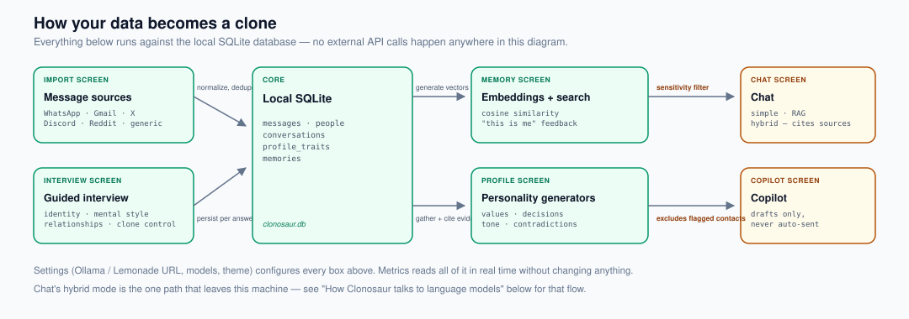
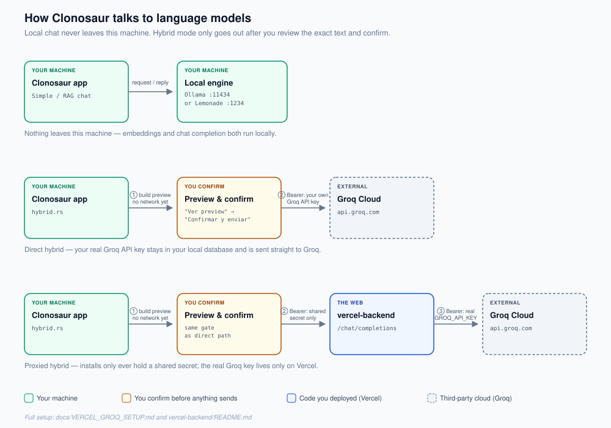

# Clonosaur

A local-first desktop app (Tauri + React + TypeScript + Rust) for creating a
personal agent based on your way of writing, remembering, and deciding. See
[docs/ROADMAP.md](docs/ROADMAP.md) for the product vision and
[docs/PLAN_TECNICO.md](docs/PLAN_TECNICO.md) for the phase-by-phase build order.

Your raw data (imported messages, interview, memories, profile) lives
entirely in a local SQLite database (`clonosaur.db`) and never leaves your
machine unless you explicitly enable hybrid mode (see
[docs/PRIVACY.md](docs/PRIVACY.md)).

A browser-only scaffold also exists (`npm run dev`, no Tauri/Rust needed) —
screens render and navigate, and there's now a real SQLite database backing
it (`wa-sqlite` compiled to WASM, persisted in OPFS via a dedicated Worker),
but the Rust command logic itself isn't ported to TypeScript yet. See
[docs/WEB_VERSION.md](docs/WEB_VERSION.md) for the full plan,
`src/backend/invoke.ts` for how the same components run in both, and
`src/backend/db.ts`/`db.worker.ts` for the OPFS-backed database.

## Architecture

Two diagrams, two questions. The first is "where does my data go once I
import it?" — the answer is: nowhere, it stays in one local database that
every screen reads from and writes to. The second is "what happens when I
use hybrid mode?" — the one deliberate exception, and it only ever fires
after you've reviewed the exact text and clicked confirm.

### How your data becomes a clone



- **Import → local database.** Six importers (WhatsApp, Gmail Takeout,
  Twitter/X, Discord, Reddit, generic `.json`/`.csv`/`.txt`) and the guided
  interview all normalize into the same tables (`messages`, `people`,
  `conversations`, `profile_traits`, `interview_answers`). Duplicate
  detection runs on every import so re-importing the same export never
  doubles your history.
- **Database → understanding.** Two independent processes read that
  database: embeddings generation + cosine-similarity search (`Memory`
  screen), and the personality generators — values, decision patterns,
  contextual tone, and contradiction detection (`Profile` screen) — which
  cite the evidence they used for every trait they produce.
- **Understanding → use.** Chat and Copilot both draw on the same profile
  and memory data. Before either one reaches the model, messages already
  classified as sensitive at import time are filtered out, and any contact
  you've excluded is skipped — the same two gates apply everywhere, not
  screen by screen.

### How Clonosaur talks to language models



- **Local (Simple / RAG chat):** the app talks only to a local engine
  (Ollama or Lemonade Server) on your own machine. Nothing goes out.
- **Hybrid, direct:** you review the exact text on screen and confirm,
  then it's sent straight to Groq using your own API key, stored locally.
- **Hybrid, via proxy:** same preview/confirm gate, but the app sends a
  shared secret (not your real key) to your own `vercel-backend` deploy,
  which holds the real Groq key server-side and forwards the request.
  Useful when distributing the app so nobody else's install needs your
  real key — see [docs/VERCEL_GROQ_SETUP.md](docs/VERCEL_GROQ_SETUP.md)
  and [vercel-backend/README.md](vercel-backend/README.md).

## How it works, screen by screen

### Import

Six parsers turn raw exports into the same normalized shape: a WhatsApp
`.txt`/`.zip` export, Gmail Takeout `.mbox` (a hand-written RFC822/MIME
parser — no external email dependency), Twitter/X, Discord, and Reddit
archives (all three are "your content only," so authorship is never
ambiguous), and a generic `.json`/`.csv`/`.txt` fallback for anything else.
Every importer runs the same duplicate check (text + timestamp + author)
before inserting, and every detected contact can be tagged by relationship
type (family, partner, friend, work, acquaintance, other) from the
Privacy screen.

### Interview

A fixed set of questions grouped into six modules — identity, mental
style, communication, relationships, autobiographical memory, and "clone
control" (what the clone is and isn't allowed to do on your behalf). Each
answer persists as soon as you leave the field, not when you finish the
whole interview, and everything here is later fed as evidence to the
personality generators.

### Memory

Generates embeddings (Ollama's `nomic-embed-text` by default, or whatever
model your configured engine exposes) for every imported message, and
searches them by in-memory cosine similarity — a deliberate choice for
personal-data volumes, not an attempt at arbitrary-scale vector search.
Every result shows its author, date, and source, and you can correct
authorship directly from a result with "this is me" / "not me" feedback
buttons. Messages you search for manually can include ones flagged
sensitive (with a warning label); the automatic context built for Chat
never includes them.

### Profile

Split into manual editing and automatic generation. You can create, edit,
or delete any trait by hand at any point. On top of that, four generators
read your interview answers, confirmed memories, and your own messages to
propose traits with cited evidence, which you review before they count as
confirmed:

- **Values** — up to 8 values grounded in the "Identity" interview module.
- **Decision patterns** — grounded in "Mental style" and "Autobiographical
  memory."
- **Tone by context** — groups your own messages by conversation and
  describes how your tone shifts between them.
- **Contradictions** — compares already-confirmed memories against each
  other over time, looking for real changes of opinion rather than
  ordinary evolution.

Nothing a generator proposes becomes part of your profile without
explicit approval — the same review step applies to all four.

### Chat

Three modes, one shared context-builder:

- **Simple** — talks to your local engine with a minimal system prompt
  (non-impersonation disclaimer + your "clone control" rules, if any).
- **With memory (RAG)** — adds your full profile, the last 20
  confirmed/edited memories, and the top 5 most relevant messages by
  embedding similarity, and shows exactly which of those it used under
  "Sources used." Responses stream token-by-token, with `<think>...</think>`
  reasoning blocks filtered out even when the tag splits across network
  chunks.
- **Hybrid** — the only mode that can reach an external provider (Groq by
  default, or any OpenAI-compatible endpoint). It never sends anything
  until you've seen the exact rendered text and hit confirm; you can
  anonymize contact names first, and every send is logged to an
  auditable history.

### Copilot

Same context-assembly as RAG chat, but the output is always a draft
sitting in a pending queue — never an automatic send. Excluded contacts
are checked before the model is ever called, not filtered out of the
result afterward.

### Privacy

Where sensitivity classification, contact exclusion, selective deletion,
and encryption at rest live. Messages are scored sensitive/not at import
time with a keyword heuristic (no LLM involved), and that flag is what
Chat and Copilot check before building context. You can delete data by
source, by contact, or by date range — deleting a source or contact
cleans up every place that referenced it (memories, conversation
participants, drafts) so nothing is left orphaned. A "Seguridad" section
lets you set a master password (AES-256-GCM + Argon2id over the whole
database file), lock/unlock on demand, and do a full reset (typing an
exact confirmation phrase). See [docs/PRIVACY.md](docs/PRIVACY.md) for
the full list of guarantees.

### Metrics

A read-only dashboard computed from the live database: embedding
coverage, memories by status, attribution feedback, drafts by status,
interview progress, and session/turn counts. Nothing here is hardcoded —
it's recalculated from whatever state your database is actually in.

### Settings

One screen for everything that used to risk being hardcoded in a dozen
places: local engine URL and API style (Ollama's native API, or an
OpenAI-compatible one like Lemonade Server), default chat and embedding
models, and visual theme. The app opens with a brief splash; the first
time you save Settings, navigation collapses into a focused mode (just
Chat, with everything else behind "Advanced options").

## Current status

| Phase | Content | Status |
|---|---|---|
| 0 — Scaffold | Tauri + React + TS app that opens | Done |
| 1 — Schema and persistence | Local SQLite, guided interview, manually editable profile | Done |
| 2 — Memory and search | Embeddings via Ollama (`nomic-embed-text`), cosine similarity search, attribution feedback | Done |
| 3 — More local sources | WhatsApp, Gmail Takeout, Twitter/X, Discord, Reddit, and generic importers; duplicate detection; contact classification | Done |
| 4 — Advanced personality | Candidate memories, values/decisions/tone models, contradiction detection | Done |
| 5 — Chat and hybrid mode | Local chat, RAG, streaming, external provider with mandatory preview | Done |
| 6 — Copilot and safeguards | "Write like me", sensitivity, metrics, selective deletion, encryption at rest | Done |
| 7 — Voice and startup UX | Local transcription, splash/onboarding, centralized settings | Done |

Encryption at rest (`vault.rs`) uses AES-256-GCM + Argon2id over the whole
database file, with a "decrypt to working copy, re-encrypt on lock" pattern
— see [docs/PRIVACY.md](docs/PRIVACY.md). There's no password recovery: if
you lose the master password, the data is unrecoverable by design. Local
voice transcription (`transcription.rs`) uses `whisper-rs`/whisper.cpp;
building it on Windows needs the MSVC C++ toolchain and CMake, which is why
`dev.bat`/`build.bat` exist instead of plain `npm run tauri dev`/`build` —
see those two files for what they set up.

## Requirements

- Node.js 20.19+ / 22.12+ and npm.
- Stable Rust + Cargo.
- [Ollama](https://ollama.com) running on `localhost:11434`, with at least:
  - `nomic-embed-text` (embeddings/semantic search).
  - A chat model (e.g. `gemma3:4b` or similar) for the Phase 4
    personality generators.
  - (Or any OpenAI-compatible local engine, e.g. Lemonade Server or LM
    Studio — see Settings.)
- **Web build only** (not needed for the Tauri desktop app, which has no
  CORS restriction): a plain browser tab can't reach
  `http://localhost:11434` unless Ollama allows that origin. Start Ollama
  with `OLLAMA_ORIGINS="*"` (or the site's exact origin) set in its
  environment — this is the same CORS requirement Open WebUI and similar
  browser-based Ollama clients have, not specific to Clonosaur. Without it,
  "Simple chat" and "Chat with memory" will show a connection error with
  this same instruction.

## Development

```sh
npm install
npm run tauri dev
```

The local database is created in the app's data directory (`clonosaur.db`),
managed automatically by Tauri — no manual configuration required.

## Repo structure

```text
src/                  React + TypeScript frontend (one screen per file)
src-tauri/
  src/                Rust backend: one module per area (db, interview,
                       profile, memory, feedback, importers, etc.)
  db/schema.sql        Core SQLite schema, applied idempotently
docs/                  Product documentation and technical plan
vercel-backend/        Optional Vercel proxy for hybrid mode (see
                       docs/VERCEL_GROQ_SETUP.md)
```
